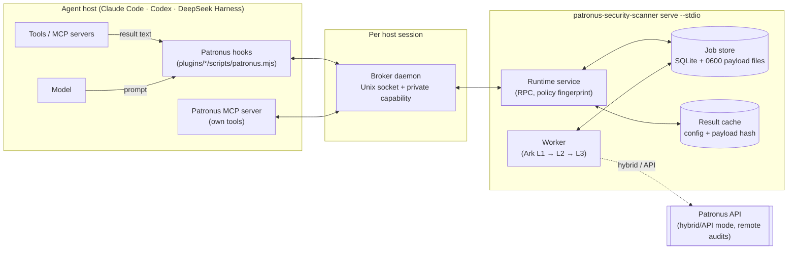
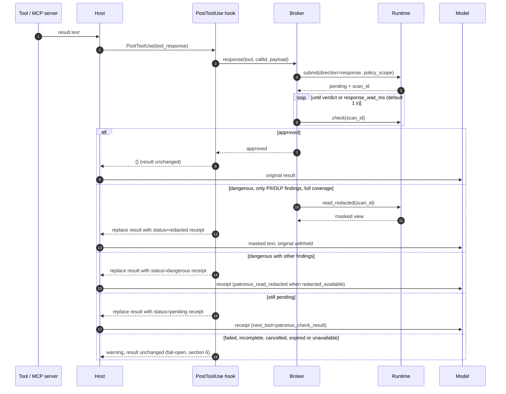
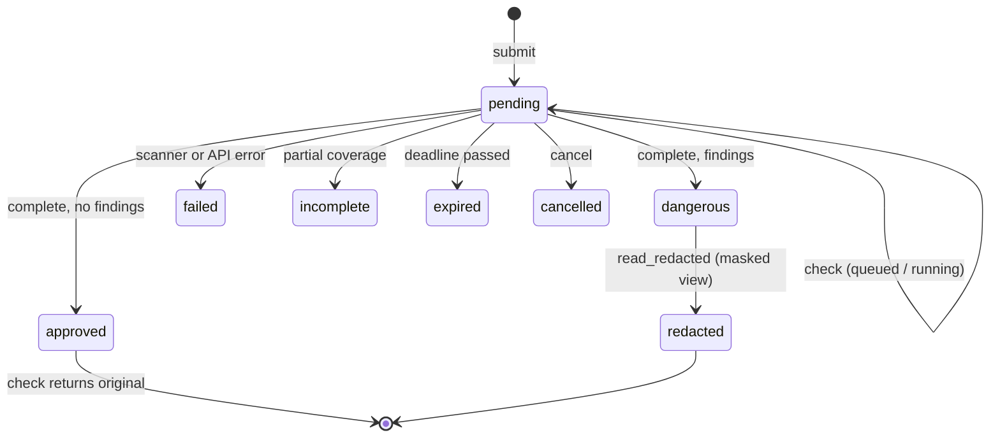
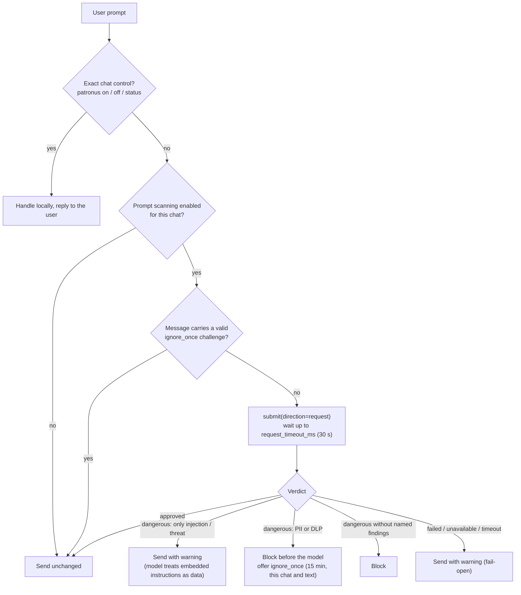
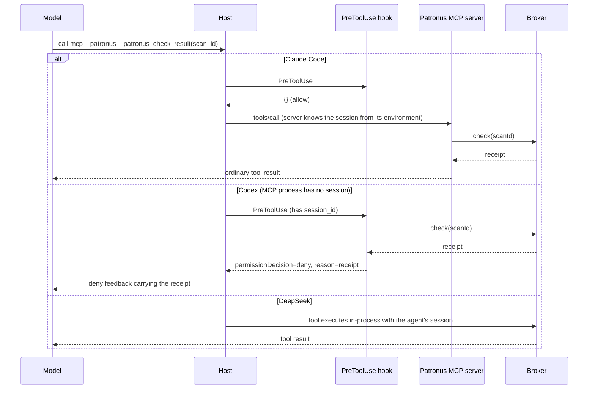
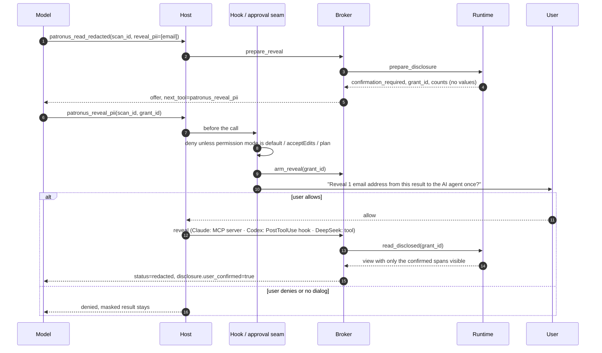
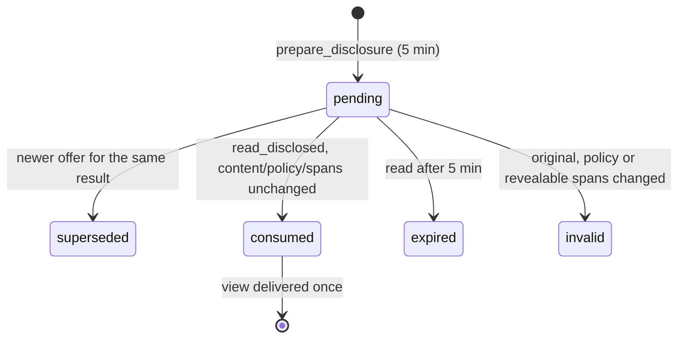
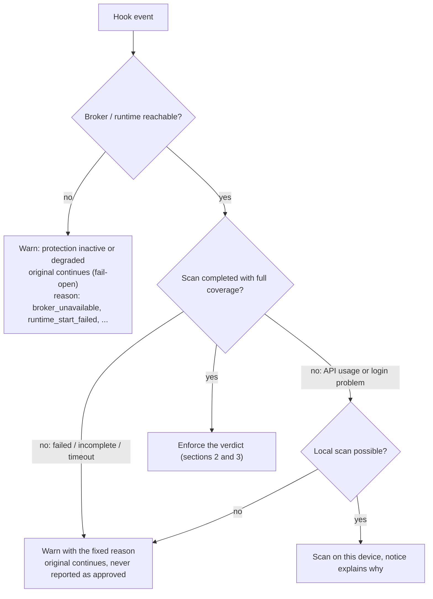
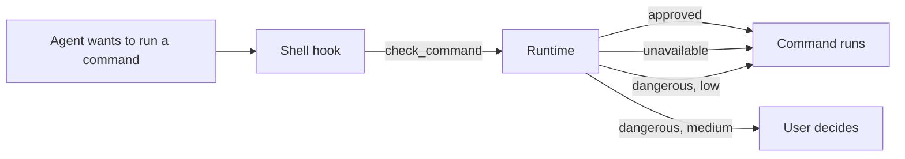

# Runtime protection flows

This document is the binding description of how the Patronus runtime
integrations move text through hooks, the session broker and the local
scanner. [runtime-text-contract.md](runtime-text-contract.md) defines *which*
text is scanned; this document defines *how* each flow runs. A test
(`tests/runtime_flows_doc.rs`) fails when a hook event, runtime RPC method or
receipt status exists in the code but is missing here.

## 1. Components

- **Hooks** run as short-lived processes per host event. Model arguments never
  carry a session or capability; the hook input's `session_id` does.
- **Broker** (`plugins/native/src/broker.ts`, `daemon.ts`): one daemon per host
  and session, started lazily by the first hook and stopped by `SessionEnd`
  (Claude) or `Stop` (Codex), or after 30 minutes idle. Frames carry the
  session's private capability; the runtime stores jobs under
  `blake3(capability)`, so other sessions cannot read them.
- **DeepSeek Harness** loads the same logic in-process
  (`plugins/deepseek/src`): its tool hooks, approval seam and agent identity
  replace the hook processes and broker socket.
- **Runtime** (`src/runtime`): accepts jobs, scans them in one worker, stores the
  original and the masked view, and serves status. Unchanged text under the same
  scanner configuration and policy scope reuses a cached verdict.

### Hook events

| Host event | Claude Code | Codex | Purpose |
| --- | --- | --- | --- |
| `SessionStart` | yes | yes | Registers the session; the broker starts lazily on first use. |
| `UserPromptSubmit` | yes | yes | Prompt gate (section 3) and the `patronus on/off/status` chat controls. |
| `PreToolUse` | yes | yes | Shell gate for `Bash` command lines (section 7), Patronus' own tools (section 4) and disclosure arming (section 5). Other tool requests are not scanned. |
| `PostToolUse` | yes | yes | Result gate (section 2). Codex also delivers approved disclosures here. |
| `PostToolUseFailure` | yes | — | Result gate for the error text of a failed tool. |
| `SessionEnd` | yes | — | Closes the broker and runtime session. |
| `Stop` | — | yes | Closes the broker and runtime session. |

Cursor names its own events; the hook bundle maps them onto the flows above
(protection level **partial**, see `plugins/cursor/README.md`):

| Cursor event | Handled as | Purpose |
| --- | --- | --- |
| `beforeSubmitPrompt` | `UserPromptSubmit` | Prompt gate; `continue: false` blocks the prompt. |
| `beforeShellExecution` | `PreToolUse` (Shell) | Shell gate (section 7): `deny` or `ask` with the hint as `user_message`. |
| `beforeReadFile` | `PostToolUse` (Read) | Result gate for file content; a finding denies the read and the agent receives the receipt or the masked file. |
| `postToolUse` | `PostToolUse` | Result gate for shell output (warn only) and MCP text (replaced); answers Patronus' own MCP tools. |
| `stop` | `Stop` | Closes the broker and runtime session. |
| `sessionEnd` | `SessionEnd` | Closes the broker and runtime session. |

### Runtime RPC methods

| Method | Caller | Effect |
| --- | --- | --- |
| `hello` | broker | Versions, provider and runtime limits. |
| `submit` | broker | Enqueues a `request` (prompt) or `response` (result) job; returns `pending` and a `scan_id`. |
| `check_command` | broker | Classifies one shell command line before it runs (section 7); synchronous, nothing stored. |
| `check` | broker | Job status; the original only for an approved response. |
| `read_redacted` | broker | The masked view of a dangerous response; may queue one local injection refinement (`pending`). |
| `cancel` | broker | Cancels an unfinished job (used for prompts that did not complete in time). |
| `prepare_disclosure` | broker | Offers a one-time PII disclosure: counts per type and a `grant_id`, never values. |
| `read_disclosed` | broker | Consumes an approved grant once and returns the disclosed view. |

## 2. Result gate (tool and MCP results)

How the replacement reaches the model:

| Host | Replace result | Warn |
| --- | --- | --- |
| Claude Code | `PostToolUse.updatedToolOutput` in the tool's own shape; `PostToolUseFailure` stops the turn with the receipt. | `systemMessage` for the user plus `additionalContext` for the model. |
| Codex | `decision: "block"` with the receipt as `reason`. | `systemMessage` plus `additionalContext`. |
| DeepSeek | `tools/post-execute` returns a `block` decision with the receipt as feedback. | Degraded-protection notice on the result. |
| Cursor | MCP: `updated_mcp_tool_output`. File read: `beforeReadFile` `permission: "deny"` with the receipt as `user_message`. Shell output cannot be replaced; it gets a warning. | `additional_context` for the model. |

The source tool already ran; receipts tell the model never to run it again to
recover its result.

### Pending results

`pending` receipts carry `job_status`; a queued job adds
`wait_reason=scanner_queue`, which is backpressure, not failure. The model
calls `patronus_check_result` with the `scan_id`; an approved response then
returns the verified original, a PII/DLP-only dangerous one the masked view.

## 3. Prompt gate (`UserPromptSubmit`)

PII is excluded from prompt scanning by default; `analysis.user_prompt_pii`
opts it in. A prompt job that did not complete in time is cancelled. `ignore_once` is a private nonce bound to
host, chat and prompt digest; only the user can type it, so the model cannot
release a blocked prompt.

## 4. Patronus' own tools

`patronus_check_result`, `patronus_read_redacted`, `patronus_reveal_pii` and
`patronus_scan` must run in the right session. Each host gets there differently:

`patronus_scan` runs explicit static audits (file, directory, repo) locally and
URL or MCP audits through the API. Remote audits retry network errors and
502/503/504 twice with one idempotency key. Static findings use `file_id`,
never a runtime `scan_id`.

## 5. Selective PII disclosure

A user can let the agent see selected PII types from one redacted result, once.
Only results whose every finding is PII qualify; with any prompt-injection, DLP
or threat finding nothing becomes readable.

| Host | Who asks the user | How a release is delivered |
| --- | --- | --- |
| Claude Code | PreToolUse returns `permissionDecision: "ask"` with the question; this forces the dialog even when Patronus tools are pre-allowed. | MCP server, only for an armed offer. |
| Codex | `.mcp.json` sets `approval_mode = "prompt"` for `patronus_reveal_pii` (Codex fails open on a PreToolUse `ask`); the hook shows the question as a notice. | PostToolUse hook replaces the MCP placeholder; a denied call never reaches it. |
| DeepSeek | The tool calls the Harness approval seam; only `allowed-once` releases. | The tool itself. |
| Cursor | Nobody: a hook cannot request Cursor's approval dialog, so disclosure answers `disclosure_unavailable`. | Never released. |

Revealable are only exact L1 evidence spans of the confirmed types; other or
unknown PII types and chunk-level verdicts stay masked and win on overlap. Card
security codes and expiry dates are never revealable. The view is built from
the hash-checked original and is never stored or cached.

## 6. Failures and fail-open

- Scanner and integration failures never block the host. They warn the user and
  the model that the content is unverified, and journal the fixed reason.
- A completed finding is always enforced: a dangerous original never continues.
- Exceptions to fail-open: a failing disclosure hook denies the call, and a
  disclosure needs a prompting permission mode.
- Every hook writes `hook_started` and `hook_completed` to the protocol journal
  (`src/protocol_event.rs`) with decision, outcome and duration, never content.

## 7. Shell gate (before a command runs)

Every host checks a shell command line before it runs. The scanner classifies only the command
string with Ark's `cat-shell-risk-commander` (L1, ~2.5 MB, prepared by `assets prepare`); it never
executes, parses or expands it. Prompts and results never go through this model.

The runtime keeps the model current by itself: when the bundle is missing or from another pinned
revision (for example after an upgrade to a new Ark release), it downloads the pinned revision once
in the background and answers `unavailable` with `shell_model_updating` until it is in place. A
failed download is retried at most every 10 minutes.

| Score | Risk | Decision |
| --- | --- | --- |
| at or below `external_commands_1pct_fpr` (0.658) | none | Runs. |
| above it, at or below `block_0_1pct_fpr` (2.242) | `low` | Runs. In this band only routine developer work scored (`rm -rf build/` 0.7, `git push --force` 1.3, `kill -9` 1.5, `npm install` 1.8). |
| above `block_0_1pct_fpr` | `medium` | The user decides: Claude `permissionDecision: "ask"`, Cursor `permission: "ask"`, DeepSeek `ask` through its approval service. Codex rejects a hook `ask`, so the hook holds the command and issues `patronus_allow <token>`; only the user's next message can carry it, and it releases exactly that command once. |

Patronus never blocks a command on its own. The thresholds are the two policies in the pinned
model; a model without `block_0_1pct_fpr` keeps every flagged command at `medium`. Above it the
scores do not separate attacks from destructive developer work well enough for a block tier:
a reverse shell scores 3.4 next to `git reset --hard` at 3.6.

Measured scores (QA corpus `qa/hooks/shell.json`): ordinary commands score below the threshold;
`npm install` 2.5, `rm -rf node_modules` 2.0 and `git reset --hard` 3.7 are medium; exfiltration,
reverse shells, `curl … | sh` and `sudo rm -rf /` score 6.4 to 11.5. A missing model or runtime
fails open. The `shell_command` hook setting (`plugins hook shell_command false`) and a paused
chat turn the gate off.

## Receipt and disclosure statuses

| Status | Meaning |
| --- | --- |
| `pending` | Scan not finished; keep the `scan_id` and call `patronus_check_result`. |
| `approved` | Complete scan without findings; the original is released. |
| `dangerous` | Findings; the original is withheld for good. |
| `redacted` | Usable masked view in `result` (or a disclosed view with `disclosure`). |
| `failed` | The scan did not complete; content is unverified. |
| `incomplete` | Coverage was partial; content is unverified. |
| `cancelled` | The job was cancelled. |
| `expired` | The job passed its deadline or retention. |
| `unavailable` | Unknown, foreign or expired `scan_id`, or the scanner is unreachable. |
| `confirmation_required` | Disclosure offer with counts and `grant_id`, waiting for the user. |
| `nothing_to_reveal` | No revealable PII of the requested types, or the result is not pure PII. |
| `disclosure_unavailable` | Offer missing, already used, denied, or no approval dialog. |
| `disclosure_expired` | The grant is older than five minutes. |
| `disclosure_invalid` | Content, policy or revealable spans changed since the offer. |
